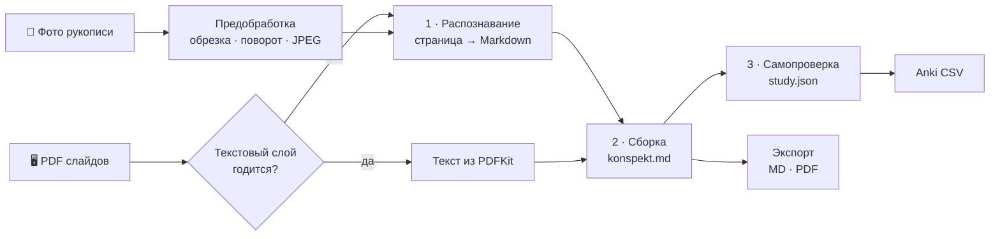

<div align="center">


# Inkling

**Фото конспекта на входе, чистый конспект и карточки для самопроверки на выходе.**

Нативное приложение для macOS. Распознаёт рукописные конспекты и слайды преподавателя
по химии, математике и физике, собирает из них аккуратный конспект с формулами
и готовит вопросы, тест и флеш-карточки.


-10A37F)


</div>

---

## Что умеет

| | |
|---|---|
| 📸 **Импорт откуда угодно** | Перетаскивание из Finder и «Фото», ⌘V (в том числе с iPhone), «Добавить файлы…», Камера непрерывности: снимок или скан документа прямо с iPhone. |
| ✂️ **Подготовка фото** | Автообрезка и выпрямление листа через Vision и Core Image, поворот по EXIF, HEIC → JPEG. Оригинал хранится всегда. |
| 🖥️ **Слайды без лишних вызовов** | Текст слайдов берётся из текстового слоя PDF. В модель уходят только страницы, где текста нет или он похож на мусор. |
| ✍️ **Распознавание рукописи** | Каждая страница превращается в Markdown с LaTeX и `\ce{…}` для химии. То, что не читается, помечается `[неразборчиво]`, модель не угадывает. |
| 🧩 **Сборка конспекта** | Страницы склеиваются без дублей на стыках. Слайды помогают сверить рукопись, недостающее добавляется блоками `📎 Из слайдов`, сомнительные места помечаются `⚠️ Возможно, ошибка`. |
| 🧠 **Самопроверка** | Резюме, термины, вопросы с решениями по шагам, тест из 10 вопросов и флеш-карточки. Прогресс сохраняется, есть режимы «Только ошибки» и «Повторить незнакомые». |
| 📤 **Экспорт** | Markdown, PDF A4 с формулами, CSV для Anki с тегами `предмет::тема`. |
| 🕰️ **История и «Устарело»** | Перед перезаписью версия уходит в историю, восстановление в один клик. Если поменялись исходные страницы, конспект помечается устаревшим. |

## Как это работает



Распознавание запускается само после импорта. Сборку вы запускаете кнопкой «Собрать», когда проверили страницы и их порядок. Учебные материалы делаются по кнопке или автоматически, если это включено в настройках.

### Движки

Своих API-ключей у Inkling нет. Приложение вызывает уже установленные инструменты:

- **Claude Code** (`claude -p`) — основной движок, работает по подписке Claude Pro. Каждый вызов изолирован: отдельная временная папка, без MCP, хуков и ваших настроек, из инструментов доступно только чтение.
- **Codex** (`codex exec`) — для подписки ChatGPT, если Claude нет. Вход один раз командой `codex login`. Написан по документации OpenAI и пока **не проверен вживую**: нужны отзывы тех, у кого есть подписка.
- **Ollama** с моделью `inkling-ocr` (Qwen3.5-9B) — необязательный локальный запасной движок. Включается, когда кончился лимит, или вручную через меню «Модель». Всё, что сделала локальная модель, помечено «проверьте».

Почему не Gemini, описано в [`docs/cli-notes.md`](docs/cli-notes.md).

## Установка

Готовая сборка лежит в [Releases](https://github.com/nkkalmyk/inkling/releases) (подписана Personal Team, без нотаризации: при первом запуске см. «Если ругается Gatekeeper» в [`docs/INSTALL.md`](docs/INSTALL.md)). Либо соберите из исходников:

Нужны Mac на Apple Silicon с macOS 26 или новее, Xcode, [XcodeGen](https://github.com/yonaskolb/XcodeGen) и выполненный вход в Claude Code (или в Codex через ChatGPT).

```bash
brew install xcodegen
xcodegen generate
xcodebuild -scheme Inkling -configuration Release -destination 'platform=macOS' \
  -derivedDataPath build/DerivedData build
ditto build/DerivedData/Build/Products/Release/Inkling.app /Applications/Inkling.app
```

Подпись, Gatekeeper, первый запуск и установка Ollama подробно описаны в [`docs/INSTALL.md`](docs/INSTALL.md).

## Где лежат данные

Всё хранится в обычных файлах, без базы данных: `~/Documents/Inkling/` (папку можно поменять в настройках). Папка нормально живёт в iCloud: запись атомарная, выгруженные файлы скачиваются, конфликтные копии показываются предупреждением.

```
Inkling/
  _prompts/                  промпты, их можно править
  <Предмет>/
    <ГГГГ-ММ-ДД — Тема>/
      meta.json              порядок страниц, хеши, движки
      notes/                 «Мой конспект»: оригиналы, обработанные фото, текст страниц
      slides/                «Слайды»
      konspekt.md            собранный конспект
      study.json             вопросы, тест, карточки
      progress.json          ваш прогресс
      history/               прошлые версии
```

Промпты лежат в `_prompts/` и правятся как обычные Markdown-файлы. Для каждого предмета можно добавить свою вставку в `_prompts/subjects/<Предмет>.md`.

## Разработка

```bash
xcodegen generate && xcodebuild -scheme Inkling -destination 'platform=macOS' build test
```

Живые тесты с настоящим Claude и Ollama по умолчанию выключены, потому что тратят лимит и память. Как их включить, написано в [`CLAUDE.md`](CLAUDE.md).

| Папка | Что внутри |
|---|---|
| `Inkling/App` | точка входа, `AppDelegate`, настройки, центр движков |
| `Inkling/Library` | состояние библиотеки для интерфейса, импорт и правка источников |
| `Inkling/Pipeline` | конвейер: `Recognition` (страницы), `Assembly` (конспект), `Study` (учебные материалы), `Prompts` (шаблоны запросов) |
| `Inkling/Engine` | `AIEngine`, Claude Code, Codex, Ollama, поиск бинарников, запуск процессов, распознавание лимитов |
| `Inkling/Import` | импорт файлов, буфер обмена, Камера непрерывности |
| `Inkling/Processing` | обработка фото и PDF, загрузка картинок страниц |
| `Inkling/Storage` | файловое хранилище, атомарная запись, iCloud, история, `konspekt.md` |
| `Inkling/UI` | экраны по папкам: `Sidebar`, `Lecture`, `Sources`, `Notes`, `Study`, `Settings` |
| `Inkling/Export` | Markdown, PDF, Anki |
| `Inkling/DesignSystem` | токены и компоненты интерфейса |
| `Inkling/Resources/Web` | рендер конспекта: KaTeX, mhchem, markdown-it |

### Документация

- [`docs/INSTALL.md`](docs/INSTALL.md) — установка для человека
- [`AGENTS.md`](AGENTS.md) — установка для ИИ-агента и правила работы с репозиторием
- [`CHANGELOG.md`](CHANGELOG.md) — что менялось в каждой версии
- [`docs/HISTORY.md`](docs/HISTORY.md) — история создания: этапы, решения, хронология
- [`docs/PROBLEMS.md`](docs/PROBLEMS.md) — проблемы, ограничения и что дальше
- [`SPEC.md`](SPEC.md) — техническое задание и принятые решения (раздел 13)
- [`docs/design-system.md`](docs/design-system.md) — дизайн-система: цвета, шрифты, компоненты
- [`docs/AUDIT.md`](docs/AUDIT.md) — аудит безопасности и надёжности, статус исправлений
- [`docs/cli-notes.md`](docs/cli-notes.md) — разведка CLI: флаги, форматы ответов, ошибки
- [`docs/local-models.md`](docs/local-models.md) — сравнение локальных моделей
- [`docs/e2e-report.md`](docs/e2e-report.md) — отчёт о сквозном прогоне

## Сторонний код

В бандл встроены [KaTeX](https://katex.org) 0.18.10 с расширением mhchem и [markdown-it](https://github.com/markdown-it/markdown-it) 15.0.2, оба под лицензией MIT. Версии зафиксированы в [`Inkling/Resources/Web/vendor/VERSIONS.md`](Inkling/Resources/Web/vendor/VERSIONS.md). Всё работает офлайн.

<div align="center">
<sub><i>ink</i> — чернила, <i>inkling</i> — догадка.</sub>
</div>
